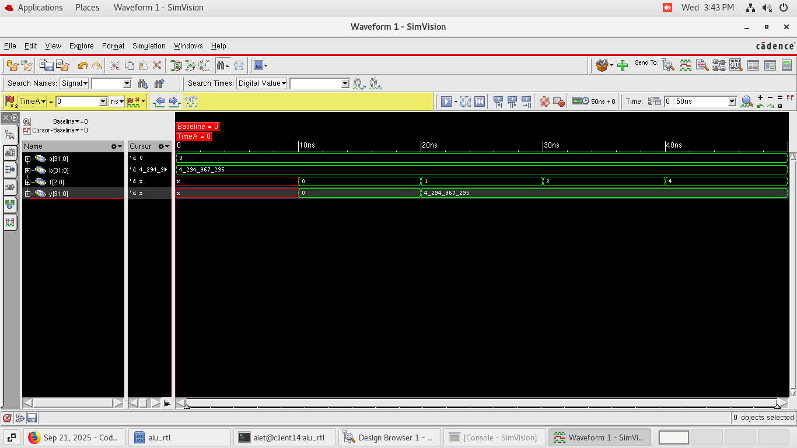
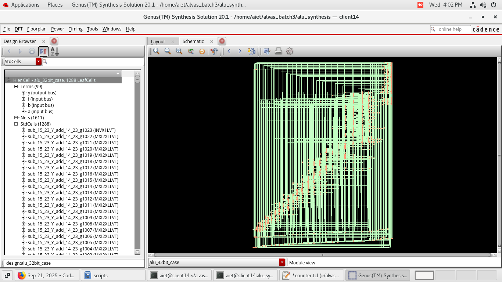
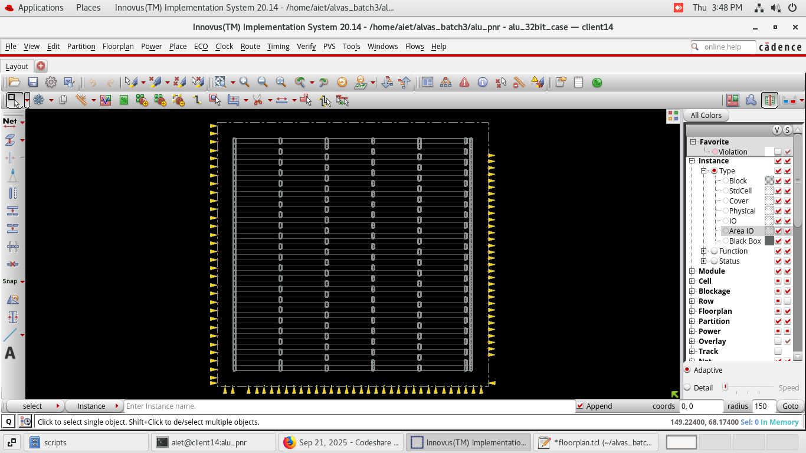
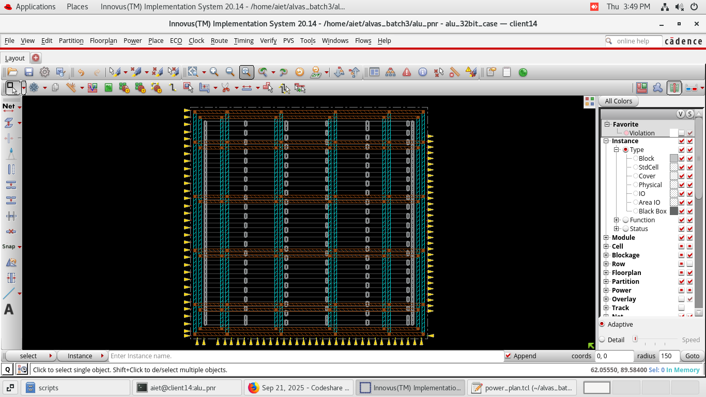
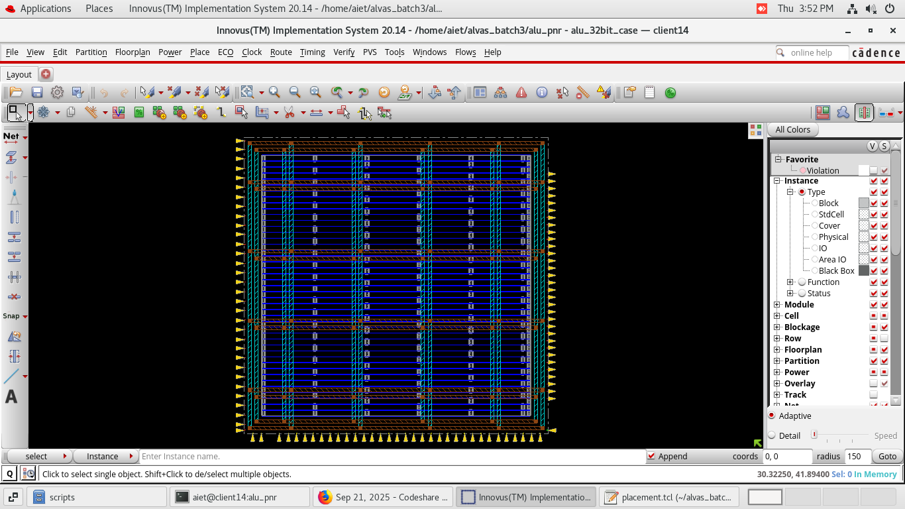
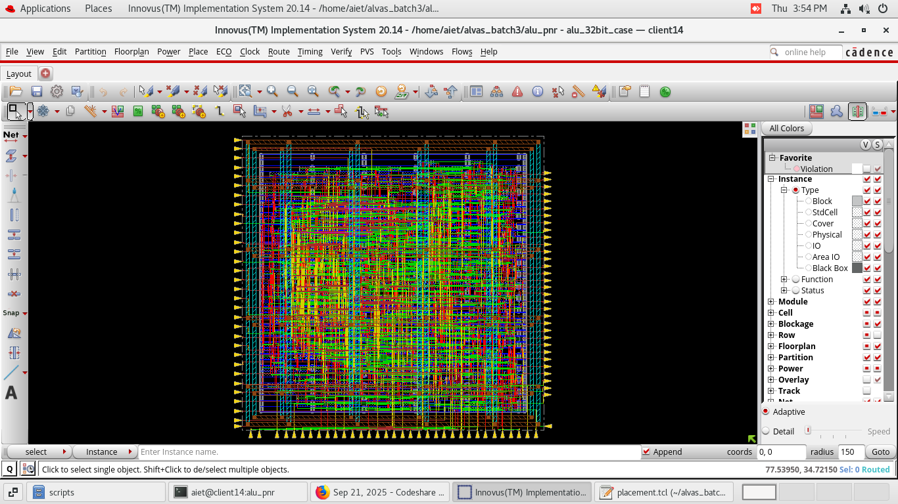
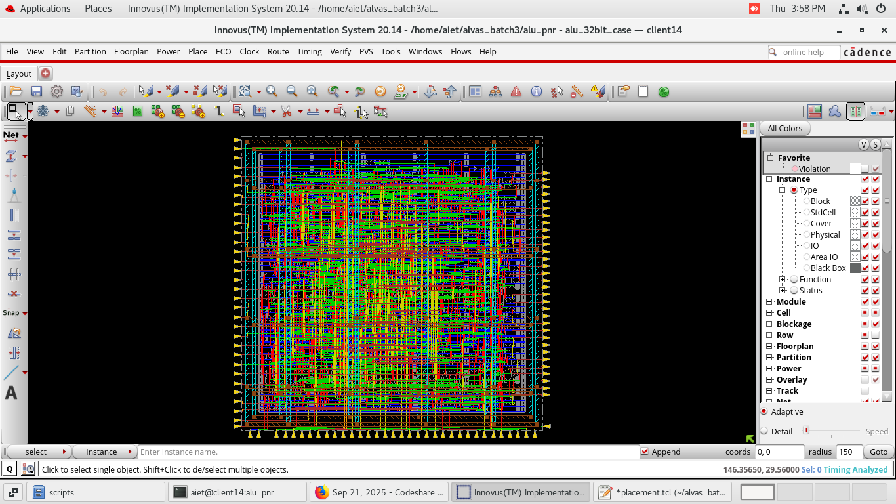
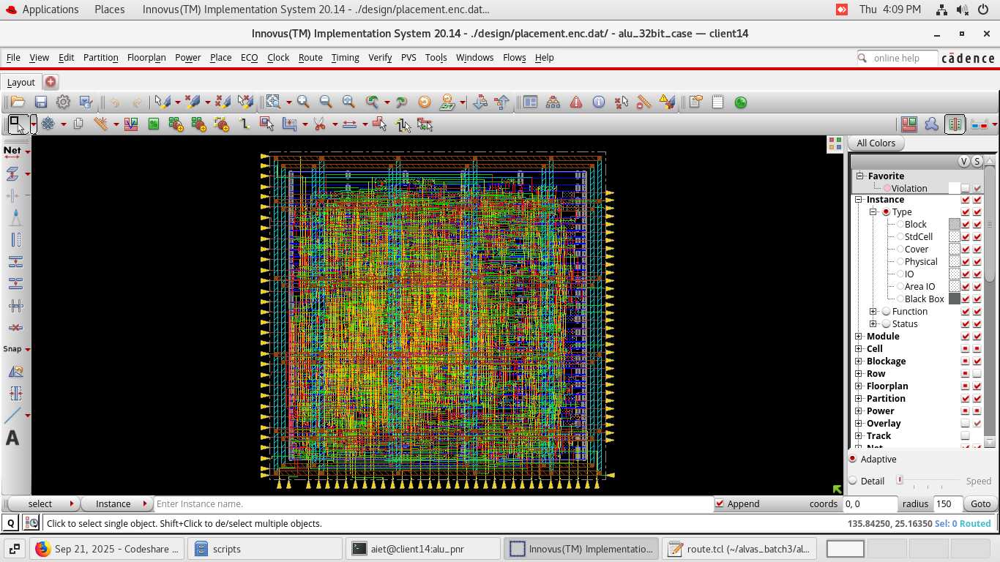

# ASIC Physical Design of 45nm 32-bit ALU (Netlist-to-GDSII)


-green)


This repository contains the complete **ASIC Physical Design (Place and Route - PnR)** implementation of a **32-bit Arithmetic Logic Unit (`alu_32bit_case`)** using **Cadence Innovus Implementation System (v20.14)** and a **45nm standard cell PDK (`gsclib045`)**. 

The design flow executes all physical design stages from gate-level netlist import, floorplanning, power grid network design (PG Mesh), standard cell placement, Clock Tree Synthesis (CTS via CCOpt), global/detail routing (NanoRoute), DRC/connectivity verification, up to final **GDSII layout stream-out**.

---

## 📌 Design Specifications & PnR Metrics

| Parameter / Feature | Specification Details |
| :--- | :--- |
| **Top-Level Module** | `alu_32bit_case` (32-bit inputs `a`, `b`, 3-bit operation select `f`, 32-bit output `y`) |
| **Operations Supported** | ADD, SUB, MUL, AND, OR, NAND, NOR, Reserved |
| **Technology Node** | 45nm CMOS (`gsclib045` standard cell library, HVT & LVT variants) |
| **Synthesis Tool** | Cadence Genus Synthesis Solution (v23.16) |
| **PnR EDA Tool** | Cadence Innovus Implementation System (v20.14) |
| **Target Clock Frequency** | **185.18 MHz** (Clock Period: `5.4 ns`) |
| **Core Utilization** | **50% – 55%** |
| **Core Aspect Ratio** | `1.0` (Square core geometry) |
| **Core Margins** | `5 µm` on Left, Right, Top, Bottom |
| **Power Grid Network** | Core PG Rings (Metal8/Metal9), Horizontal Stripes (Metal9), Vertical Stripes (Metal8) |
| **Physical Cells** | WellTap cells (`FILL2`/`FILL4` @ 45µm pitch), EndCap cells (`FILL2`/`FILL4`) |
| **Routing Layers** | Metal1 (Bottom) to Metal7 (Top Routing Layer) |
| **Analysis Corners (MMMC)** | **Setup Corner**: `func_ss` (`slow_vdd1v0`) \| **Hold Corner**: `func_ff` (`fast_vdd1v0`/`fast_vdd1v2`) |

---

## 📁 Repository Directory Structure

```
alu-physical-design-45nm/
├── README.md                          # Comprehensive project documentation
├── .gitignore                         # Cadence Innovus log & binary database filter
├── rtl/                               # Verilog RTL source files & testbench
│   ├── alu_32bit_case.v               # 32-bit ALU Verilog module
│   ├── alu_32bit_case_tb.v            # Testbench for ALU verification
│   └── run.sh                         # Simulation script
├── inputs/                            # Design netlist, SDC constraints, and MMMC configs
│   ├── Default.globals                # Innovus global environment & library pointers
│   ├── Default.view                   # MMMC view definitions (Corner setup)
│   ├── alu_netlist.v                  # Gate-level Verilog netlist (Cadence Genus output)
│   └── alu_sdc.sdc                    # Synopsys Design Constraints
├── scripts/                           # Modular TCL physical design scripts
│   ├── master_flow.tcl                # Master script to run full PnR flow sequentially
│   ├── floorplan_new.tcl              # Floorplanning, pin assignment & physical cells
│   ├── floorplan.tcl                  # Comprehensive floorplan script with dbGet queries
│   ├── power_plan.tcl                 # VDD/VSS Power rings, stripes, and sroute rails
│   ├── placement.tcl                  # Global/detail placement & pre-CTS timing opt
│   ├── cts.tcl                        # Clock Tree Synthesis (CCOpt), latency & skew opt
│   └── route.tcl                      # NanoRoute global/detail routing & GDSII export
├── reports/                           # PnR Stage Reports
│   ├── area.rpt                       # Core area & cell count summary
│   ├── power.rpt                      # Dynamic & leakage power report
│   ├── timing.rpt                     # Setup & hold slack timing report
│   ├── drc_check.rpt                  # Geometry & DRC violation report
│   └── pin_check.txt                  # Pin assignment verification log
└── images/                            # Innovus GUI snapshots & Layout Screenshots
    ├── 01_rtl_simulation_waveform.png # RTL Simulation Waveform
    ├── 02_genus_synthesis_schematic.png # Genus Gate-Level Schematic
    ├── 03_floorplan_pin_placement.png # Floorplan & IO Pin Placement
    ├── 04_power_grid_mesh.png         # Power Grid Network (VDD/VSS Rings & Stripes)
    ├── 05_sroute_std_cell_rails.png   # Standard Cell Power Rails (sroute)
    ├── 06_std_cell_placement.png      # Standard Cell Placement View
    ├── 07_pre_route_interconnect.png  # Pre-Route Interconnect Wire Trails
    └── 08_routed_layout_2d.png        # 2D Final NanoRoute Layout (GDSII Ready)
```

---

## 🛠️ Physical Design Flow Stages

### 1. RTL Simulation & Logic Synthesis
- **RTL Design**: 32-bit ALU implementing arithmetic (`+`, `-`, `*`) and logical operations (`AND`, `OR`, `NAND`, `NOR`).
- **Synthesis Engine**: Synthesized using Cadence Genus into 45nm standard cell netlist (`alu_netlist.v`).

| RTL Simulation Waveform | Genus Gate-Level Schematic |
| :---: | :---: |
|  |  |

---

### 2. Floorplanning & Power Planning (PG Mesh)
- Core initialization with aspect ratio 1.0, 50% utilization, and 5µm core margins.
- IO pin distribution across top/bottom/left/right boundaries.
- Power rings (Metal8/Metal9), power stripes (Metal8/Metal9), and standard cell rails (Metal1 `sroute`).

| Floorplan & Pin Placement | Power Grid Network (PG Mesh) | Standard Cell Power Rails |
| :---: | :---: | :---: |
|  |  |  |

---

### 3. Placement & Routing (NanoRoute)
- Standard cell placement with Congestion & Timing optimization (`place_opt_design`).
- Pre-route interconnect analysis.
- NanoRoute detailed routing from Metal1 through Metal7 with zero DRC violations.

| Standard Cell Placement | Pre-Route Interconnect | 2D Final Routed Layout |
| :---: | :---: | :---: |
|  |  |  |

---

## 🚀 How to Run the Flow in Cadence Innovus

To execute the physical design flow interactively or in batch mode inside Cadence Innovus:

```bash
# Launch Cadence Innovus
innovus -files scripts/master_flow.tcl
```

Or step-by-step in the Innovus TCL console:

```tcl
source inputs/Default.globals
init_design
source scripts/floorplan_new.tcl
source scripts/power_plan.tcl
source scripts/placement.tcl
source scripts/cts.tcl
source scripts/route.tcl
```

---

## 👨‍💻 Author

**ShivuAH**  
ASIC Physical Design / VLSI Engineer  
[GitHub Repository](https://github.com/ShivuAH/alu-physical-design-45nm)
